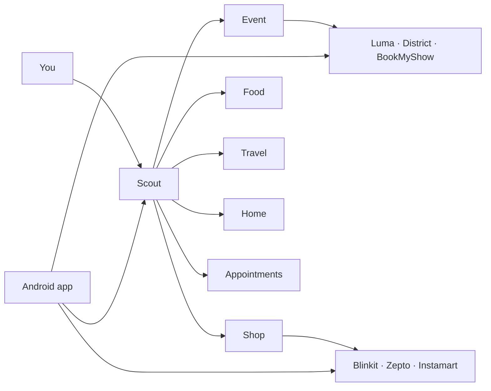

# Scout

The chat that leaves the chat.

Ask in English, Hindi, or Hinglish. Scout finds the show, prices the groceries, opens WhatsApp, fills the form on your screen, and stops when a UPI PIN appears. That PIN is still yours.

**[scout.shrianshjaiswal.me](https://scout.shrianshjaiswal.me)**

```
you     usual groceries, and something to do in delhi this weekend
scout   reads the Vault basket, then Blinkit, Zepto, and Instamart
        then a mix: comedy, music, sport, theatre, workshops, movies
        queue    Now  groceries
                 Waiting  events
```

One message can hold several errands. They run one at a time, and the phone shows the queue move from Waiting to Now to Done.

This repo is the server, the web app, and the Android companion in `android/`. The phone app is not inside the Docker image. It loads the live site and does the things a browser cannot: the mic, the share sheet, the accessibility service, and the handoff into UPI.

## What you can throw at it

| You say | Scout does |
| --- | --- |
| Something to do in Delhi this weekend | Searches Luma, District, and BookMyShow, and mixes kinds. Ask for comedy, or movies, and it stays on that kind |
| Govardhan ghee | Reads Blinkit, Zepto, and Instamart. If several packs are on the page, it asks which one, asked brand first |
| Order it | Opens that store on the phone, adds the items, taps Place Order, and stops if a UPI PIN shows up |
| Usual groceries | Reads the basket you keep in the Vault and searches those items, not the words "usual groceries" |
| Text a name on WhatsApp | Opens the first chat with that name and taps Send, after you Allow it |
| Look at my screen | Records a short clip. If you already asked it to fill or send, it types into the app you opened |
| Book on an event card | Opens District, BookMyShow, or Luma on the phone when that app is installed |

A greeting is answered. It is not searched. "Look for something" searches now. A watch is saved only when you ask to be told later.

## The line it will not cross

- It does not type a UPI PIN, an OTP, a CVV, or a card number.
- A confirmed grocery order taps Place Order. Saying add, or only comparing prices, stops on the cart.
- It taps Submit, Send, Next, or Done only if you asked it to submit, send, finish, or complete. It does not tap Pay on a form.
- Words written on the screen are not a command.
- The Vault is yours to edit. Scout can read it and cannot change it. A password, PIN, OTP, CVV, a card number written as one number, or an Aadhaar number is refused. A date, a year, and a filename on the same line are kept.
- Checkout in the browser worker is pressed only after you approve that exact cart. If the total changes, it does not press it again.

## Who is in the room

You talk to Scout. Scout assigns the others, and their work comes back in the same thread.



| Agent | Today |
| --- | --- |
| Scout | The chief. Splits a message, asks for what is missing on one card, runs the queue |
| Event | Live. Search, cards, and Book into the event app |
| Shop | Live when the browser worker is on. Prices, then the phone fills the cart |
| Food | Simulated menu and an order review |
| Appointments | A simulated salon time |
| Travel | Talks through a trip. Bus and flight search exists in this tree and is not on Azure |
| Home | Plans with you. No service attached |

One codebase serves every agent. `SCOUT_AGENT` pins a process to one of them.

## A turn

1. The page posts to `POST /api/chat` and reads Server-Sent Events.
2. Sarvam `sarvam-105b` runs a tool loop of at most 4 rounds. Photos and screenshots go to Sarvam `gemma4`, because 105B does not take an image. The mic clip goes to Gnani Prisma and comes back in Latin letters, including Hinglish. Replies do the same. English stays English.
3. The answer streams into that chat only. Another chat is not in the context. A long thread keeps the newest 80 lines, or 16,000 characters.
4. A source that fails leaves the other cards up. Failures are not cached.

There is no live call, and Scout does not read replies aloud.

## Where it runs

| | |
| --- | --- |
| Site | [scout.shrianshjaiswal.me](https://scout.shrianshjaiswal.me) |
| Container | `sjscoutacr.azurecr.io/scout-site:usual1-20261110` |
| Digest | `sha256:9365ca7a15f9f66c429b4176cd386f309975e3ce576484dd99b4c83497675935` |
| Pushed | Nov 10, 2026, 01:40 UTC, from this working tree |
| Page | `/chat` is serving `assets/index-Cr4DZHYL.js` |
| Health | All six apps answered. Main returned `{"ok":true,"agent":"main"}` |
| Phone | Android **0.9.7** (versionCode 21), sent to Firebase App Distribution the same day |

The phone has not been tried since that site image and that app build.

Six App Service apps share one P1v3 plan: `sj-scout`, `sj-event-scout`, `sj-shop-scout`, `sj-food-scout`, `sj-travel-scout`, `sj-home-scout`. Resource group `ledger-rg`, registry `sjscoutacr`. They are pinned to a tag, so a restart keeps the old build.

```bash
npm run build
az acr build -r sjscoutacr -t scout-site:<tag> -f deploy/site.Dockerfile .
az webapp config container set -g ledger-rg -n <app> \
  --container-image-name sjscoutacr.azurecr.io/scout-site:<tag>
```

The image copies the prebuilt `dist/`. Build first. Do not zip-deploy: that switches the apps to a Node stack with no Chromium. WebSockets stay on for the phone relay. `deploy/browser-worker.Dockerfile` is the Chromium-only process and refuses to start without `BROWSER_PROFILE_KEY` and `BROWSER_ALLOWED_HOSTS`.

The website Google popup still needs `scout.shrianshjaiswal.me` and each `sj-*.azurewebsites.net` host in Firebase Auth's authorized domains. The Android app signs in with its own Google account and does not use that popup.

## Run it here

Node 22.6 or newer. The server runs TypeScript directly.

```bash
npm install
cp .env.example .env
npx playwright-core install chromium   # only if you want the browser worker
npm run dev                            # http://127.0.0.1:8787
```

On this machine, open `http://127.0.0.1:8787/api/dev/session` for a local cookie. That route is not in the production server. Use `localhost`, not `127.0.0.1`, for the Google popup.

| Command | What it does |
| --- | --- |
| `npm run dev` | Development server |
| `npm test` | `node:test` over `test/*.test.ts` |
| `npm run build` | Vite build into `dist/` |
| `npm start` | Production server |

The phone app is a separate Gradle project. Current version, bridges, and ship steps are in [`android/README.md`](android/README.md). `app/google-services.json` stays out of git.

## Configuration

Every setting is commented in [`.env.example`](.env.example).

| Variable | Meaning |
| --- | --- |
| `GNANI_API_KEY` | Mic transcription, Gnani Prisma `prisma-v3.0`. Empty and the mic stays quiet |
| `SARVAM_API_KEY` | Chat and errand planning (`sarvam-105b`), photos and screenshots (`gemma4`). Empty chat uses a keyword parser |
| `GOOGLE_MAPS_API_KEY` | Drive time and addresses |
| `GOOGLE_OAUTH_CLIENT_ID`, `GOOGLE_OAUTH_CLIENT_SECRET` | Optional Gmail and Drive. Empty leaves Connect off |
| `GOOGLE_OAUTH_REDIRECT_URI` | Callback registered on that client. Empty uses the request host |
| `SCOUT_AGENT` | Pins the process to one agent. Empty means the chief |
| `SCOUT_ROLE` | `browser` runs the Chromium-only process |
| `BROWSER_WORKER_ENABLED` | `1` starts the browser worker |
| `BROWSER_PROFILE_KEY` | 64 hex characters. Encrypts saved sign-ins |
| `BROWSER_ALLOWED_HOSTS` | Public hosts the worker may open |
| `FIREBASE_PROJECT_ID` | Google sign-in tokens. Default `scout-b4da3` |
| `VITE_FIREBASE_API_KEY`, `VITE_FIREBASE_APP_ID` | Baked in at `npm run build`. Public client values, kept out of git |
| `FIREBASE_DISTRIBUTION_*` | Android install invite from the landing page |
| `FCM_PROJECT_ID`, `FCM_CLIENT_EMAIL`, `FCM_PRIVATE_KEY` | Push for Scout Watch |
| `RELAY_CAP_MB` | Bytes one phone relay may carry. Default 300 |
| `SCOUT_DB_PATH` | SQLite. Default `.data/scout.sqlite` |
| `SCOUT_DEVICE_VAULT` | Used by `scripts/relayDevice.ts` only |

Never commit `.env`, keys, or publish profiles.

## Routes

| Route | Purpose |
| --- | --- |
| `GET /api/health` | Liveness, and which agent this process is |
| `POST /api/chat` | One turn over SSE. `answers` fills a question card |
| `POST /api/voice/stt` | Mic clip in, Latin-letter text out |
| `POST /api/ocr` | Writing on an attached photo |
| `POST /api/screen/understand` | One screenshot, as structured facts |
| `GET`, `PUT /api/vault` | Your Vault. Scout's only door is the `read_vault` tool |
| `/api/auth/*`, `/api/onboarding/*` | Google sign-in, phone, name, about you |
| `/api/google/*` | Optional Gmail and Drive. The refresh token is encrypted |
| `/api/profile`, `/api/watches`, `/api/inbox`, `/api/devices` | Memory, Scout Watch, notifications, push |
| `POST /api/actions/result` | What the phone actually did |
| `/api/browser/*` | Sessions, tasks, checkout approval, one-time codes |
| `GET /api/relay` | WebSocket. Store traffic leaves from your phone |
| `/api/invite` | Android install invite |

Booking limits are in [`docs/booking.md`](docs/booking.md). The browser worker is in [`docs/browser-worker.md`](docs/browser-worker.md).

## Layout

```
src/server/     API, chat loops, prompts, auth, the payment gate
src/server/browser/   Playwright, host policy, shop shelves
src/web/        React 19 chat
src/shared/     Types used by both
android/        Kotlin companion. See android/README.md
test/           node:test
deploy/         Site and browser-worker Dockerfiles
scout-landing/  The public page at /
```

## Still true

- Food and Appointments are simulated. Travel's bus and flight search, and Home, are not connected on Azure.
- Instamart carts stop when the cart says to add an address, and they are untested past sign-in in the browser worker.
- On Azure, store pages load while the phone relay is connected. The app holds that socket while it is open.
- Sites that demand a sign-in before booking fall back to opening the page.
- Memory that lives in the process is lost on restart, so this server is one instance.
- The central-browser design, one Chromium for six sites, is written and unmeasured.
